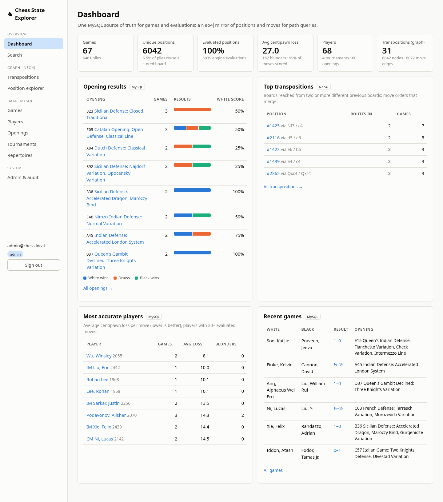

# Chess State Explorer

**Database for Opening Transpositions and Game Analytics**
Vinaayak G Dasika (PES2UG24CS588) · Vignesh Nunna (PES2UG24CS582)

A chess engine can score one board, but it cannot tell a player where they habitually go wrong, or show every move order that reaches the same board. This project stores games, players, openings, tournaments, board positions and engine evaluations in **MySQL** for integrity and aggregate analytics, and mirrors positions and moves into **Neo4j** to answer move-order path questions: transpositions, opening trees and novelties. A **Next.js** web app provides the interface; it talks to both databases only through the project's API routes.



## What it does

| Area | Features | Database |
| --- | --- | --- |
| Game import | Legal-move PGN import; every board stored once (canonical FEN), so two move orders that transpose share one position row; atomic rollback | MySQL |
| Analytics | Opening win rates (GROUP BY/HAVING), per-player centipawn loss and blunders (view + stored procedure), most-visited boards (window function), evaluation coverage | MySQL |
| Transpositions | Boards reached from 2+ different boards; every move order that reaches a board and which games played it | Neo4j |
| Opening tree | Variable-length continuation tree from any board, pruned by popularity | Neo4j |
| Novelty detection | Where a game first left all other stored games, with the alternatives others played | MySQL + Neo4j |
| Search | Full-text search over players, openings, tournaments | MySQL FULLTEXT |
| Audit | Trigger-written JSON snapshots of every evaluation insert/delete | MySQL |
| Accounts | **admin** (read/write) and **analyst** (read-only); scrypt password hashes, hashed expiring tokens, lockout | MySQL |

Sample data: 67 real games from three October 2026 Lichess broadcasts (`data/sample_games.pgn`), with every reachable position scored by Stockfish 19 at depth 14.

## Architecture

```text
Browser ── Next.js pages (Server Components) ── Server Actions (CSRF-checked, HttpOnly session cookie)
                         │ fetch with Bearer token
                         ▼
           /api/**/route.ts  (validation · role check · explicit transactions · prepared SQL / Cypher)
              │                                     │
          MySQL 8.4 (source of truth)          Neo4j (derived graph mirror)
          tables · FK/CHECK/UNIQUE · views      (:Position)-[:MOVE]->(:Position)
          procedure · triggers · FULLTEXT        constraints · indexes · path queries
              │                                     ▲
              └── graph_outbox (trigger-written) ── relay /api/graph/sync (idempotent)
```

Details: [docs/DATABASE.md](docs/DATABASE.md) (schema, Neo4j model, sync design, important queries), [docs/API.md](docs/API.md) (HTTP contract), [docs/TESTING.md](docs/TESTING.md) (results).

## Prerequisites

- Node.js 22+ and npm. The team uses the **`db_lab` conda env**, which provides Node 26, Stockfish 19 and pandoc: `conda activate db_lab`.
- MySQL **8.4** and Neo4j (Community, 5.x / 2026.x). Easiest: Podman or Docker; `scripts/dev-db.sh` starts both.
- Optional: `stockfish` on `PATH` (or `STOCKFISH_PATH`) to score the sample positions.

## Setup

```bash
conda activate db_lab
npm ci
cp .env.example .env.local        # set DB_PASSWORD, MYSQL_ROOT_PASSWORD, NEO4J_PASSWORD (and ports if needed)
npm run db:up                     # starts chess-mysql + chess-neo4j containers (podman or docker) and waits for both
npm run db:init                   # one-time: schema, views, procedure, triggers, seed, migrations
```

`docker compose --env-file .env.local up -d` works too (it now includes Neo4j). Already have MySQL? Create an empty `chess_intel` database with `utf8mb4_unicode_ci` and skip the container. Creating triggers with binary logging enabled requires `log_bin_trust_function_creators` (set by both the script and Compose for this local teaching database).

`db:init` refuses any non-empty database: MySQL DDL implicitly commits, so a half-applied init must be inspected, not re-run. Later schema changes are numbered files in `database/migrations/`, applied exactly once by `npm run db:migrate` and recorded in `schema_migration`.

Create accounts (the password is read from the environment and never stored in plain text):

```bash
read -rsp 'Admin password (12+ characters): ' BOOTSTRAP_PASSWORD; export BOOTSTRAP_PASSWORD
npm run user:create -- admin@example.com admin
read -rsp 'Analyst password (12+ characters): ' BOOTSTRAP_PASSWORD; export BOOTSTRAP_PASSWORD
npm run user:create -- analyst@example.com analyst
unset BOOTSTRAP_PASSWORD
```

Run the app and load the sample data:

```bash
npm run dev                                                     # http://localhost:3000
ADMIN_EMAIL=admin@example.com ADMIN_PASSWORD=... npm run data:load   # 67 games via the API, then Stockfish evaluations
npm run graph:sync                                              # push queued changes into Neo4j
```

`data:load` goes through the real HTTP API (login → players/tournaments/openings → PGN import → evaluations), so it exercises the same validation and transactions as the UI. It strips PGN comments first (Lichess stacks several per move, which chess.js's strict parser rejects). `--evaluate-only` resumes scoring without re-importing.

## Using the app

Sign in at `http://localhost:3000/login`.

- **Dashboard**: table sizes, evaluation coverage, opening results, top transpositions, most accurate players, recent games.
- **Games**: filter by player/opening; open a game to step through it (← → keys), see the evaluation chart, blunders, the novelty move and SQL move-quality stats. Admins can import PGN, edit metadata and delete.
- **Position explorer**: find a board by FEN or by typing moves. Try `1. d4 Nf6 2. Nf3 e6 3. c4` and `1. d4 Nf6 2. c4 e6 3. Nf3`: both open the same position, which lists both move orders and the games that played each.
- **Transpositions**: every merge point in the graph.
- **Players / Openings / Tournaments / Repertoires**: CRUD (admin), analytics and full-text search.
- **Admin & audit**: graph sync status and controls, and the trigger-written evaluation audit log.

Analysts see the same data; write forms are hidden or rejected by the API with 403. Hiding buttons is only a convenience: every write is authorized again on the server.

## Useful demonstrations

1. Import the sample PGN on the import page (a Réti move order into the Queen's Gambit Declined), open its last position, and see the transposition paths.
2. Import with a nonexistent opening (via the API): the game, plies, new positions **and the outbox row** all roll back.
3. Stop Neo4j (`podman stop chess-neo4j`) and import a game: it commits, the dashboard shows "changes not yet synced", and MySQL pages keep working. Start Neo4j and press *Apply pending changes*.
4. Add then delete an evaluation on a position page; the Admin audit log keeps both JSON snapshots.
5. Sign in as the analyst and try to import or sync: 403.
6. `CALL sp_player_summary(5);`, `SHOW TRIGGERS;`, `SELECT * FROM v_move_edge LIMIT 5;` in a SQL client; `MATCH (p:Position) WHERE COUNT { (p)<-[:MOVE]-() } >= 2 RETURN p LIMIT 25` in the Neo4j browser (`http://localhost:7475` with `scripts/dev-db.sh`).

## Verification

```bash
npm test             # unit tests (no databases needed)
npm run typecheck
npm run build
```

Integration tests need a **separate MySQL database whose name ends in `_test`** and a **separate, disposable Neo4j instance** (Community edition has one database and the graph tests rebuild it). Put both in `.env.test.local` (never commit it), then:

```bash
set -a; source .env.test.local; set +a
npm run db:init
npm run build && npm run start -- --hostname 127.0.0.1 --port 3100
# second shell, same environment loaded:
INTEGRATION_TESTS=1 NEO4J_TEST_OK=1 TEST_BASE_URL=http://127.0.0.1:3100 npm run test:integration
```

The suites run sequentially and remove only their own fixtures. Coverage and the latest results are in [docs/TESTING.md](docs/TESTING.md).

## Project layout

```text
src/app/(app)/          Web UI pages (dashboard, games, positions, transpositions, players, …)
src/app/login/          Sign-in page
src/app/actions.ts      Server Actions: every mutation, forwarded to the API
src/app/api/            Route handlers: route-local SQL/Cypher and transaction boundaries
src/components/         Board, game viewer, evaluation chart, move tree, forms
src/lib/                MySQL pool, Neo4j driver, outbox relay, auth, validation, chess, web API client
database/schema.sql     Original DDL, constraints, indexes, views, procedure, triggers
database/migrations/    001 graph outbox + triggers + v_move_edge, 002 FULLTEXT indexes
database/seed.sql       Initial metadata
database/ddl-demo.sql   Non-destructive CREATE/ALTER/DROP example
data/                   Sample PGN (Lichess broadcasts)
scripts/                dev-db, init, migrate, user creation, graph sync, sample loader
tests/                  Unit tests; MySQL+HTTP and Neo4j integration tests
docs/                   API, database design, testing, handoff notes, diagrams, screenshots
```

## Team contributions

| Member | Database work | Application work |
| --- | --- | --- |
| Vinaayak G Dasika | MySQL schema, constraints, indexes, views, stored procedure, evaluation triggers, transactions | Next.js API layer, PGN import, analytics endpoints, authentication and roles, backend tests |
| Vignesh Nunna | ER/relational design (iteration 1), Neo4j model, constraints and Cypher queries, transactional outbox (triggers, view, relay), FULLTEXT search, overview analytics | Next.js web interface, graph and search API routes, sample-data pipeline (Lichess + Stockfish), graph integration tests, report |

The Git history shows each member's commits.

## Security and scope limits

- Credentials live only in `.env.local` / environment variables. Passwords are salted scrypt hashes; API tokens are stored as SHA-256 hashes and expire after 12 hours. The web session is an HttpOnly, SameSite=Strict cookie; Server Actions add Next.js's Origin check (CSRF).
- The UI's server code calls the API at a fixed `INTERNAL_API_URL` (default `http://127.0.0.1:$PORT`), never at an address taken from the request's Host header.
- Local teaching deployment: use HTTPS, TLS to remote databases, a least-privilege runtime DB account (no DDL, no direct `evaluation_audit` writes) and rate limiting before exposing it publicly. Login lockout is per account.
- Standard-start, single-game, main-line PGNs only (1–1000 plies). No engine runs in the API; scores come from the loader or an admin. The graph is eventually consistent with MySQL (seconds; the UI syncs after each import/delete).

Feature slices use Conventional Commits. PDFs and local credentials are excluded from Git.
