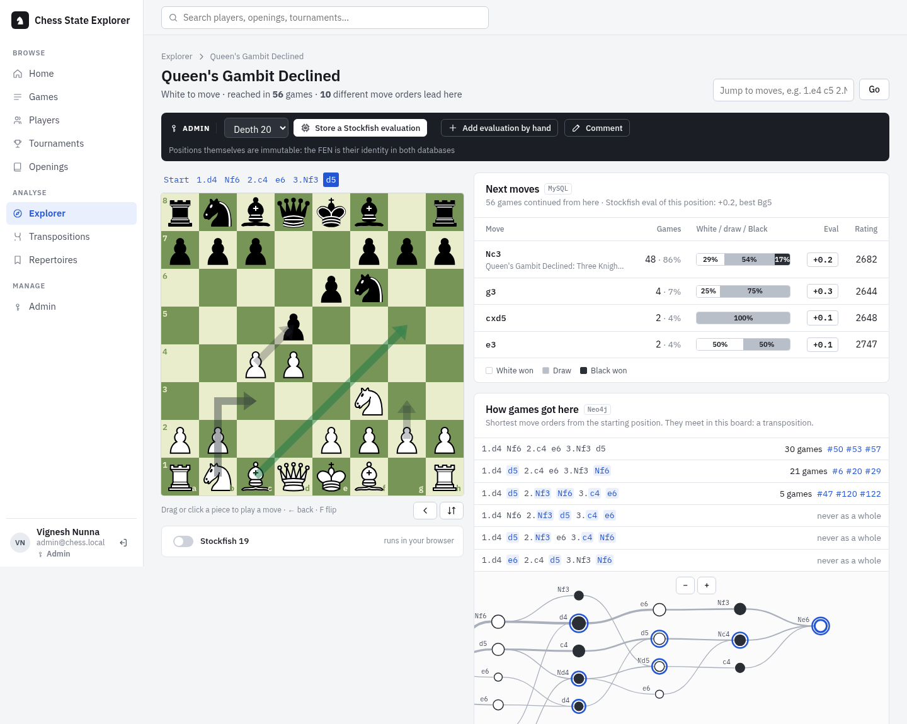

# Chess State Explorer

**Database for Opening Transpositions and Game Analytics**
Vinaayak G Dasika (PES2UG24CS588) · Vignesh Nunna (PES2UG24CS582)



## Why this exists

A chess engine answers "how good is *this one position*?". Chess.com and Lichess answer "what happened in *our* games?".
Neither answers questions about a chosen collection of over-the-board games, such as the tournaments you are preparing for:

- **Which move orders reach this position?** `1.d4 Nf6 2.c4 e6 3.Nf3 d5` and `1.d4 d5 2.c4 e6 3.Nf3 Nf6` are the same Queen's Gambit Declined. Knowing the transpositions lets you dodge an opponent's preparation.
- **What does this player actually play, and where do they leave it?** Their opening tree as White and as Black, their usual move in each position (a repertoire), and every game where they deviated.
- **How accurately do they play, and when do they go wrong?** Stockfish scores every position; average centipawn loss, blunders and the move Stockfish preferred.
- **Where did a game leave known theory?** The first move no other stored game played (the novelty).

That data has two shapes, so it lives in two databases:

| Shape | Database | Example |
| --- | --- | --- |
| Tables: games, players, tournaments, evaluations, repertoires | **MySQL** (source of truth) | Standings, opening win rates, accuracy per player: JOIN / GROUP BY / HAVING, views, window functions, a stored procedure, triggers, transactions, FULLTEXT search |
| A graph: positions connected by moves, where different paths meet | **Neo4j** (mirror, rebuilt from MySQL) | "Every move order to this board" is one `allShortestPaths` pattern instead of a recursive SQL CTE |

The data is real: **397 classical games from 7 elite 2026 tournaments** (Candidates Open & Women, Tata Steel Masters & Challengers, Norway Chess, Sinquefield Cup, Chennai Grand Masters), imported from the **Lichess broadcast API**. Players are enriched from Lichess's **FIDE API**, with photos from **Wikimedia Commons**. Positions are named with the **Lichess opening catalogue** (3,332 openings), and all 35,282 positions are scored by **Stockfish 19**, which ships inside the app.

## Run it

You need **Podman** (or Docker) for the two databases, and the **`db_lab` conda env** (Node 26 and a native Stockfish; any Node 22+ works).

```bash
conda activate db_lab
npm install
npm run setup      # first time only, ~12 minutes: databases, schema, accounts, data, Stockfish, graph
npm run dev        # http://localhost:3000
```

`npm run setup` writes `.env.local` with random passwords if it is missing, starts the `chess-mysql` and `chess-neo4j` containers, and creates the schema (or applies new migrations). It creates an admin and an analyst account (passwords are printed once and saved to `~/.config/chess-state-explorer/accounts.txt`, never in the repo), then loads everything above. It is safe to re-run. `npm run dev` restarts the containers by itself.

Other commands: `npm run setup -- down | status` (containers), `npm test` (unit), `npm run build`. The integration tests are described in [docs/TESTING.md](docs/TESTING.md).

## Using it

| Page | What you get |
| --- | --- |
| **Explorer** | Play moves on the board (drag or click). For every position: the moves played next with results, Stockfish's eval and average rating; every move order that leads here (as a list and as a graph); what comes next (graph); the games that reached it; live Stockfish lines in your browser. |
| **Transpositions** | Positions reached by different move orders, named by opening, with the orders side by side (differences highlighted). Filter by opening family, popularity and move number. |
| **Players** | Search and filter by title or federation. A player page shows their record by colour, openings as White and Black, their personal opening graph, per-game accuracy and worst moves. |
| **Games** | Filter by player, tournament, opening and result. The viewer has an eval bar, a move list with ?? / ? marks, the move Stockfish preferred, live engine lines, the novelty and an evaluation chart. |
| **Tournaments / Openings** | Standings with performance ratings; for each opening: results, who plays it, how games continue. |
| **Repertoires** | Build a player's repertoire from their games, then see every game where they deviated. |
| **Admin** | Import a tournament from a Lichess link, run Stockfish, sync or rebuild the graph, manage accounts, read the audit log. |

**Roles.** The course asks for at least two, and here they mean something different. An **admin** maintains the shared database: imports, engine runs, edits, deletes, graph sync and accounts. Every admin-only action sits in a dark "Admin" bar at the top of the page. An **analyst** can read everything and keep **their own** repertoires; the API checks ownership on every change, not just admin status.

**The graph in Neo4j Browser** (http://127.0.0.1:7475, user `neo4j`, password from `.env.local`): run `:style` and drop [`database/neo4j/style.grass`](database/neo4j/style.grass) on it. Positions become white or black discs (side to move), transpositions get a blue ring, nodes show the move that reached them and edges show the move. [`database/neo4j/queries.cypher`](database/neo4j/queries.cypher) has queries to try.

## Demo script

1. **Explorer** → play `1.d4 Nf6 2.c4 e6 3.Nf3 d5`: "Queen's Gambit Declined, 10 different move orders lead here", shown as a list and as a converging graph.
2. **Transpositions** → filter D (closed games): every way top players reached the same positions.
3. **Players** → Sindarov: 65% score, openings by colour, his opening graph as White, his worst moves with Stockfish's choice.
4. **Repertoires** → "Praggnanandhaa R as Black": 91% consistent, plus the games where he deviated.
5. **Admin** → import another broadcast from a Lichess link, then "Score boards from new games"; the audit log fills via the trigger.
6. Sign in as the analyst: the Admin bar and page disappear, and the API returns 403 if called directly; repertoires they create are editable only by them.
7. SQL: `CALL sp_player_summary(1);`, `SELECT * FROM v_player_game LIMIT 5;`, `SHOW TRIGGERS;`.

## Architecture

```text
Browser ── Next.js pages (Server Components) ── Server Actions (CSRF-checked, HttpOnly session)
   │  Stockfish 19 WASM (live analysis, Web Worker)       │ Bearer token
   │                                                      ▼
   │                     /api/**/route.ts (validation · role/owner checks · explicit transactions)
   │                        │                          │                      │
   │                 MySQL 8.4 (truth)          Neo4j (mirror)         Stockfish 19 (server)
   │                 tables · views · procedure  (:Position)-[:MOVE]->  scores boards, stores
   │                 triggers · FULLTEXT          labels for Browser     cp / mate / best move
   │                        └── graph_outbox (trigger) ── relay /api/graph/sync ──┘
   └── Lichess broadcast + FIDE APIs, Wikidata photos (via /api/import/lichess)
```

Details: [docs/DATABASE.md](docs/DATABASE.md) (schema, migrations, Neo4j model, sync, queries), [docs/API.md](docs/API.md), [docs/TESTING.md](docs/TESTING.md), [docs/HANDOFF.md](docs/HANDOFF.md).

## Project layout

```text
src/app/(app)/        pages: home, games, players, tournaments, openings, positions (explorer), transpositions, repertoires, search, admin
src/app/api/          route handlers: SQL and Cypher live here, each owning its transaction
src/app/engine/       serves the browser Stockfish build from node_modules
src/components/       board, game viewer, explorer board, move graph, eval chart, engine panel, UI kit
src/lib/              MySQL pool, Neo4j driver + outbox relay, importer, Lichess client, Stockfish runner, auth, validation
database/             schema.sql, seed.sql, migrations/ (001 graph outbox, 002 FULLTEXT, 003 Lichess metadata), neo4j/ (Browser style, queries)
data/lichess/         cached broadcast PGNs + metadata, FIDE records, photo links
data/openings/        Lichess opening catalogue (CC0)
scripts/setup.ts      the one setup command
tests/                unit tests; MySQL+HTTP and Neo4j integration suites
```

## Team contributions

| Member | Database work | Application work |
| --- | --- | --- |
| Vinaayak G Dasika | MySQL schema, constraints, indexes, views, stored procedure, evaluation triggers, transactions | Next.js API layer, PGN import, analytics endpoints, authentication and roles, backend tests |
| Vignesh Nunna | ER/relational design, Neo4j model, labels and Cypher queries, transactional outbox, FULLTEXT search, migration 003 (Lichess metadata, per-player view, repertoire ownership) | Web interface, graph/search/import/engine API routes, Lichess + FIDE + Stockfish data pipeline, setup command, graph integration tests, report |

## Security and limits

- Credentials live only in `.env.local` / environment variables (generated by setup). Passwords are salted scrypt hashes; API tokens are stored as SHA-256 hashes and expire after 12 hours. The web session is an HttpOnly, SameSite=Strict cookie; Server Actions add Next.js's Origin check.
- Local teaching deployment: use HTTPS, TLS to remote databases, a least-privilege runtime DB account and rate limiting before exposing it publicly.
- Standard-start, main-line PGNs only (1–1000 plies). The graph is eventually consistent with MySQL (the UI syncs after every import/delete). Path queries list shortest move orders.
- Data credits: games and FIDE data © their sources via the Lichess API; opening names from lichess-org/chess-openings (CC0); player photos from Wikimedia Commons (individual licences on Commons); Stockfish is GPL-3.0 (npm package `stockfish`).
